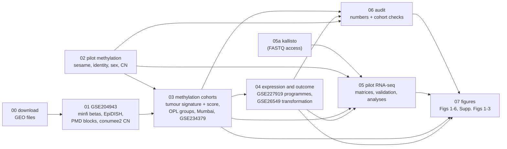

# DNA methylation and transcriptome analysis of oral potentially malignant lesions

Analysis code for the manuscript *"[title to be added]"* ([authors to be added], in preparation).

The study profiles a pilot set of oral lesions and matched adjacent mucosa with the Infinium
MethylationEPIC v2 array (8 samples) and bulk RNA sequencing (11 libraries). It then interprets
them against six public oral cohorts:

| Dataset | Content | Role here |
|---|---|---|
| GSE204943 | EPIC v1 methylation: 22 healthy, 22 leukoplakia, 74 OSCC | tumour signature, PMD blocks, copy number |
| GSE85514 | array CGH, same Mumbai patients | copy-number validation |
| GSE85195 | expression arrays, same Mumbai patients | methylation-expression, proxy training |
| GSE234379 | 450K methylation: 46 OSCC with matched adjacent tissue | replication |
| GSE26549 | expression arrays: 86 leukoplakias with oral-cancer follow-up | transformation analysis |
| GSE227919 | RNA-seq: 66 oral biopsies across histological grades | grade and progression |

Every number, table and figure in the manuscript is produced by the scripts in `scripts/`,
run in the order set by the `Makefile`.

## Quick start

```bash
# 1. software (R 4.5.2 / Bioconductor 3.22; see env/README.md)
Rscript -e 'install.packages("renv"); renv::restore(lockfile = "env/renv.lock")'
conda env create -f env/environment.yml        # kallisto, pandoc, python-docx

# 2. data locations: copy the template and edit the entries that differ on your machine
cp config/paths.local.example.yml config/paths.local.yml

# 3. public data (~2.5 GB) and the full analysis
make download         # ~2.3 GB download; ~4 GB on disk once the GSE204943 IDATs are extracted
make gse204943        # GSE204943 objects from the raw IDATs
make all              # stages 02-07: analyses, audit, figures
```

`make help` lists the targets, and `make -n all` shows what would run without running it.
The pilot IDATs and FASTQs are not public yet (see `data/README.md`). Without them, stages 00
and 01 run, but stages 02-07 need the pilot outputs.

## Pipeline



| Stage | Folder | Make target | What it does |
|---|---|---|---|
| 00 | `scripts/00_download` | `download` | Downloads GEO series matrices, platform tables and raw files, with MD5 checks |
| 01 | `scripts/01_gse204943` | `gse204943` | GSE204943 from IDATs: detection-P filtering + noob (minfi), cell fractions (EpiDISH), PMD blocks (blockFinder), copy number (conumee2), ZNF471 CpGs |
| 02 | `scripts/02_pilot_methylation` | `methylation` | Pilot EPIC v2: sesame preprocessing, QC, PCA; genotype identity, sex and copy number from raw signal |
| 03 | `scripts/03_methylation_cohorts` | `cohorts` | Composition-adjusted tumour signature and tumour-likeness score; OPL methylome groups; Mumbai same-patient cross-checks; GSE234379 and the 19q13 KZFP cluster |
| 04 | `scripts/04_expression_outcome` | `outcome` | GSE227919 programmes and grade; methylome-state expression proxy and oral cancer development in GSE26549 |
| 05 | `scripts/05_pilot_rnaseq` | `kallisto`, `rnaseq` | kallisto quantification; tximport gene matrices; RNA vs methylation readouts; paired DE, hallmarks, promoter methylation vs expression |
| 06 | `scripts/06_audit` | `audit` | Results audit of key claims, cohort verification checks, the table of every number quoted in the text, and GSE204943 integrity checks (files and labels vs GEO, sex, duplicates) |
| 07 | `scripts/07_figures` | `figures` | Nature-format figures (183 mm wide, PDF + PNG) |

`docs/pipeline.md` lists the inputs and outputs of each script. `docs/outputs_map.md`
maps each figure panel and supplementary table to the script that makes it.

## Rerunning after a change

Each Make target is a file written by one script. Its prerequisites are that script, the
shared code in `R/lib/`, the config and the outputs of the upstream scripts it reads. So:

- **After editing a script**, run `make all`. Make reruns that script and everything
  downstream of it, and nothing else. Run `make -n all` first to see the list.
- **To rerun one stage**, use its target, e.g. `make cohorts`, or
  `Rscript scripts/03_methylation_cohorts/02_opl_groups.R`.
- **Do not edit a script while `make` is running it.** R reads scripts incrementally, so an edit
  during a run can corrupt that run.
- **Check the numbers in the text.**
  - `scripts/06_audit/03_manuscript_numbers.R` writes every number quoted in the manuscript,
    formatted as in the text, to `outputs/extended/tables/manuscript_numbers.csv`. Compare it
    before and after a change to find the sentences to update.
  - `scripts/06_audit/01_results_audit.R` checks the key claims against their reported values
    in `audit_checks.csv`. Rows with status `CHECK` are claims to revisit, or reported values
    to update.
- **Separate output folders:** any path in `config/paths.yml` can be overridden for one run with
  an environment variable `OPMD_<ENTRY>`. For example,
  `OPMD_OUTPUTS=validation/test make all` writes everything under `validation/test/`, leaving
  `outputs/` alone.
- **See what changed:** `Rscript tools/compare_tables.R outputs/extended/tables
  validation/test/extended/tables` lists every table that differs between two runs, and
  the columns and size of each difference.

## Repository layout

```
config/            paths.yml (defaults), paths.local.example.yml (template for machine paths)
R/lib/             config.R (paths, helpers), sample_sheet.R, utils.R, make_paths.R
scripts/00-07/     analysis scripts, numbered in run order within each stage
resources/         curated inputs that are not computed here (e.g. exome copy-number calls)
tools/             compare_tables.R (diff two runs), build_manuscript_docx.py (Markdown -> .docx)
env/               renv.lock (R packages), environment.yml (command-line tools)
docs/              pipeline.md, outputs_map.md, CHANGELOG.md
data/              local data, git-ignored (see data/README.md)
outputs/           all results, git-ignored, regenerated by make
archive/           earlier code kept for provenance (not run by make)
```

Every script starts by sourcing `R/lib/config.R`, which defines all paths. No script contains
a machine-specific path.

## Notes on methods choices that affect numbers

See `docs/CHANGELOG.md`. In brief:

- Pilot arrays are preprocessed once with sesame `prepSesame("QCDPB")`. The earlier report
  applied this twice. `SESAME_PREP_PASSES=2` reproduces the earlier behaviour for comparison.
- GSE204943 probes are filtered on the MethylSet. The earlier pipeline applied a probe-level
  filter to bead-address rows. The frozen objects from that pipeline can still be used by
  setting `gse204943_objects` in `config/paths.local.yml`.

## Citation and licence

Manuscript citation to be added. Licence to be added.
